# FlamingoIM

[Read in English](README_en.md)

## 简介

FlamingoIM 是一套开源的企业即时通讯系统，从网络库、通信协议、服务端，到桌面客户端与管理控制台，都用 C++ 编写。网络库、协议和界面控件库都是自己实现的，没有使用 Boost、Qt、Electron 或浏览器内核这类大型框架。它由三部分组成：

- **服务端**（`flamingoserver/`）：C++11 编写，Linux 与 Windows 都能编译运行，产出 `chatserver`、`fileserver`、`imgserver` 三个服务。底层是自带的 Muduo 风格多 Reactor 网络库、异步日志与数据库访问层，这套代码本身就是一个可复用的服务器框架，也适合用来学习高性能服务器开发。数据库默认使用 SQLite，不安装任何数据库服务就能运行，改一个配置项即可切换到 MySQL；所有依赖都随仓库提供，Windows 版只依赖系统自带的 DLL。
- **PC 客户端**（`flamingoclient/`）：原生 Windows 桌面程序（Win32 + WTL），界面由自绘控件库 balloonui 绘制。主程序之外有 13 个插件 DLL，音视频、文件共享、密聊、帖子群、截图、文字识别、语音字幕、锁屏等功能各在一个 DLL 里，按需加载；某个 DLL 缺失时只隐藏对应功能的入口，不影响其余功能。界面支持 5 种语言，管理员发布新版本后客户端自动升级。
- **管理控制台**（`flamingoAdmin/`）：Windows 桌面程序。企业管理员用它维护组织架构与员工，按企业打开或关闭各项功能，配置敏感词、企业机器人与企业问答，查看审计日志与在线用户；平台运营人员用它管理多家企业，发布平台公告与客户端新版本。

除了单聊、群聊、图片与文件这些基本能力，FlamingoIM 还覆盖了企业协作中常用的实时沟通与远程协作：一对一与群语音视频通话、远程桌面、带标注与白板的屏幕共享、本地与云端录屏。两台客户端之间优先建立 P2P 直连，连不通时才经服务器中转。语音字幕在本机离线识别（中英混合，自动加标点），图片文字识别使用 Windows 自带的引擎，数据都不需要发到云端。安全方面，客户端与服务器之间的全部通信都经过加密（X25519 密钥交换 + XChaCha20-Poly1305）；密聊在此基础上再做端到端加密，消息只保存在内存里，聊天窗口禁止被截屏。

本仓库是**企业版**：通讯录直接来自企业组织架构，同一企业的同事天然互相可见、可以直接发消息，不需要「加好友」，因此没有好友申请、好友分组这类功能。

项目附带完整的测试与文档：服务端有一千三百多个 doctest 单元测试用例，客户端有五千多个 Catch2 用例；`docs/` 下有 70 多份协议与功能设计文档，另有 44 章图文[使用帮助](docs/help/help.md)。

## 功能概览

完整的图文使用说明见[使用帮助](docs/help/help.md)（也可以用浏览器直接打开 [`docs/help/index.html`](docs/help/index.html) 阅读网页版）。

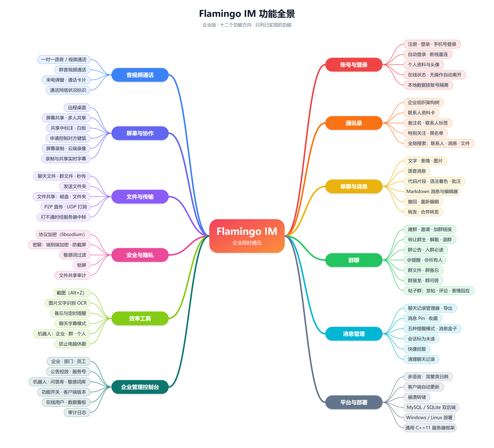

### PC 客户端

**账号与界面**

- 账号或手机号登录、记住密码与自动登录、按公司名自助注册
- 在线状态，长时间无操作自动切换为离开
- 多语言界面：简体中文、繁體中文、English、日本語、한국어。在登录窗右下角或「系统设置 → 通用 → 语言」里切换，重启后生效，也可以设为跟随 Windows 的显示语言；界面字体随语言切换，插件窗口与自动升级程序同样翻译，群里的系统提示（如某人退出群聊、转让群主）也按每个人自己的界面语言显示（见下文[运行与配置](#运行与配置)）
- 锁屏：设置临时密码后全屏锁定，五种锁屏动画
- 自动升级：管理员在控制台发布新版本后，客户端提示并自动下载安装
- 换成自己的品牌：窗口标题栏里的产品名可以改成自己公司的名字，主面板与各窗口、提示框的标题，登录与注册窗的品牌大字，「关于 / 退出」等文字都会跟着变；标语与「关于」对话框的版权文字也能替换。只改配置文件，不用改代码、不用重新编译（见下文[运行与配置](#运行与配置)）

**通讯录与会话**

- 企业组织架构通讯录，联系人资料（岗位、座机，手机号与座机的公开范围可设置）
- 联系人备注名、联系人标签、收藏
- 会话置顶、标为未读；每个会话可单独设置提醒方式：正常提醒、免打扰、收进消息盒子、特别关注，群聊还可以屏蔽消息或只提醒 @我和关注的人
- 消息盒子与公告中心，接收平台公告
- 全局搜索：联系人、群、本地聊天记录，以及服务器上的聊天记录

**聊天**

- 文字、表情、字体设置、窗口抖动、图片、文件、文件夹
- 语音消息
- 代码片段：语法着色，可为选中的代码添加批注
- Markdown 文档：独立的编辑器，收到后以卡片展示，可导出为 `.md`、`.html`、`.png`、`.pdf`、`.docx`
- 撤回与重新编辑、引用回复、Pin、多选删除、逐条转发与合并转发、快捷回复
- 截图（全局快捷键、标注）与图片文字识别（OCR）
- 密聊：端到端加密，消息只保存在内存里、不写入本地库，聊天窗口禁止被截屏

**群组**

- 群聊、@提醒、群文件、群公告（含入群必读）、群备忘、群问答、接龙
- 邀请入群、加群链接、入群审批、禁言、管理员与群权限设置、转让群主、解散与退出群聊
- 帖子群：没有聊天流，只有帖子；支持追加补充、两级留言与表情回应
- 机器人：个人机器人（替本人自动回复）与群机器人（关键词规则、外部系统推送）

**音视频与屏幕**

- 一对一语音与视频通话、群语音与视频通话
- 远程桌面
- 屏幕共享：标注、白板、申请控制对方键鼠、多人共享（由主持人审批）、密码与分享链接
- 屏幕录制：本地录制与云端录像
- 语音字幕：录屏与屏幕共享时的实时字幕，字幕编辑器，导出为烧录字幕的 MP4、带字幕轨的 MP4 或 SRT；聊天窗口的字幕模式
- 两台在线客户端之间优先建立 P2P 直连（局域网直连或 UDP 打洞），连不通时经服务器中转

**效率工具**

- 文件共享：把本机的磁盘、文件夹或文件共享到会话里，供成员浏览、下载与上传
- 备忘与提醒，可把聊天消息存为备忘
- 聊天记录管理器：跨会话搜索、时间轴、文件与图片库、本机存储占用、导出聊天记录
- 系统设置：通知、快捷键、音视频设备、本地数据存储位置与缓存清理

### 管理控制台

控制台有两种管理员角色：

- **企业管理员**：仪表板、组织架构与员工、服务号、为部门建群、查看在线用户、功能开关、敏感词、文件共享管理与审计、企业问答、企业机器人、审计日志。
- **平台超级管理员**：平台总览、企业管理（新增、审核、停用、删除）、平台公告、客户端版本发布与自动升级。

### 服务端

- Muduo 风格的多 Reactor 网络框架（Linux 用 epoll，Windows 用 select）
- v2 协议：二进制帧头加 JSON 包体，包体较大时用 zlib 压缩；连接建立后用 X25519 交换密钥、XChaCha20-Poly1305 加密全部帧体（libsodium）
- MySQL 与 SQLite 两种数据库后端，同一份程序由配置项切换，首次启动自动建库建表
- 实时音视频、远程桌面等数据的中转，以及 P2P 连接所需的 UDP 地址探测
- 面向管理控制台的 HTTP 接口，以及推送在线用户变化的长连接
- 机器人引擎（规则回复、Webhook、调用外部 HTTPS 服务）、敏感词过滤、已发消息被改写后的离线同步
- 依赖全部随仓库提供：MariaDB Connector/C 与 zlib 从源码编译，libsodium 为预编译静态库；Windows 产物只依赖系统 DLL

## 界面截图

截图取自[使用帮助](docs/help/help.md)，人名与数据均为演示数据。

<table>
<tr>
<td align="center">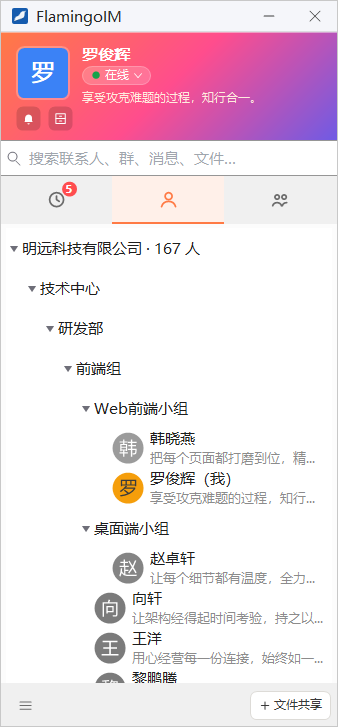<br>主面板（组织架构通讯录）</td>
<td align="center"><br>单聊</td>
</tr>
<tr>
<td align="center">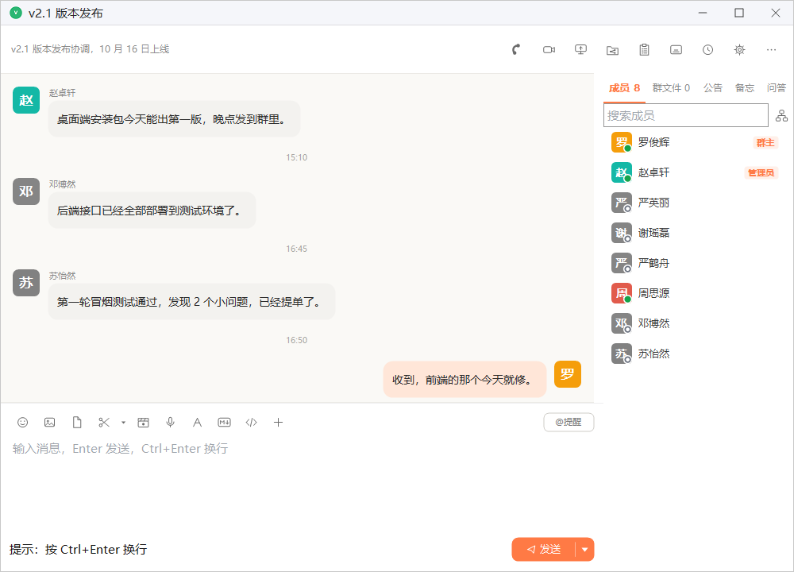<br>群聊</td>
<td align="center"><br>帖子群</td>
</tr>
<tr>
<td align="center">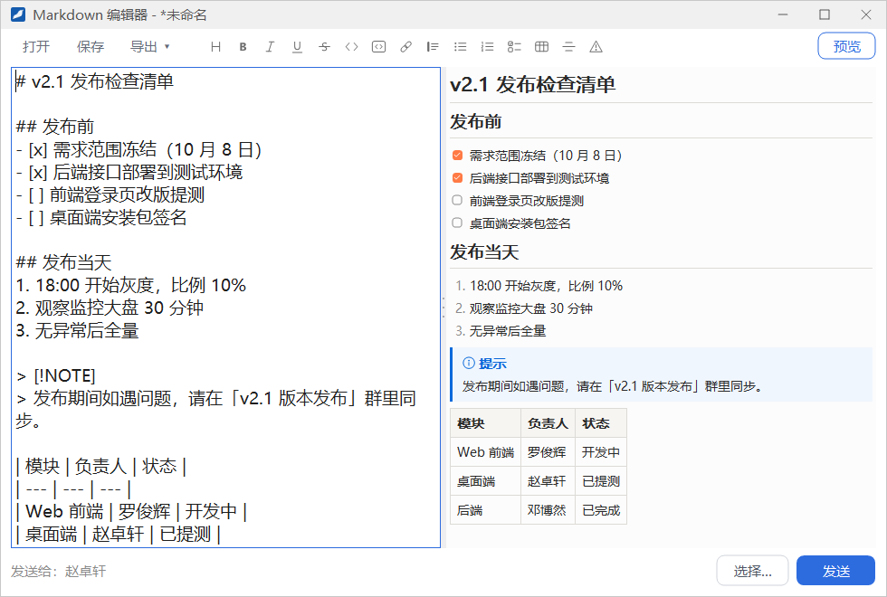<br>Markdown 编辑器</td>
<td align="center">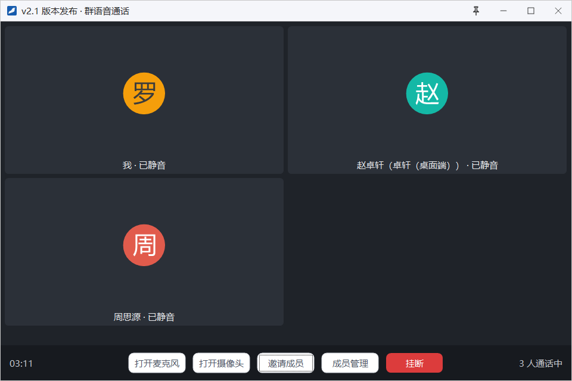<br>群语音通话</td>
</tr>
<tr>
<td align="center">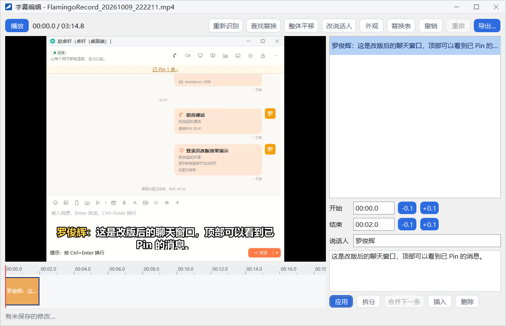<br>字幕编辑器</td>
<td align="center">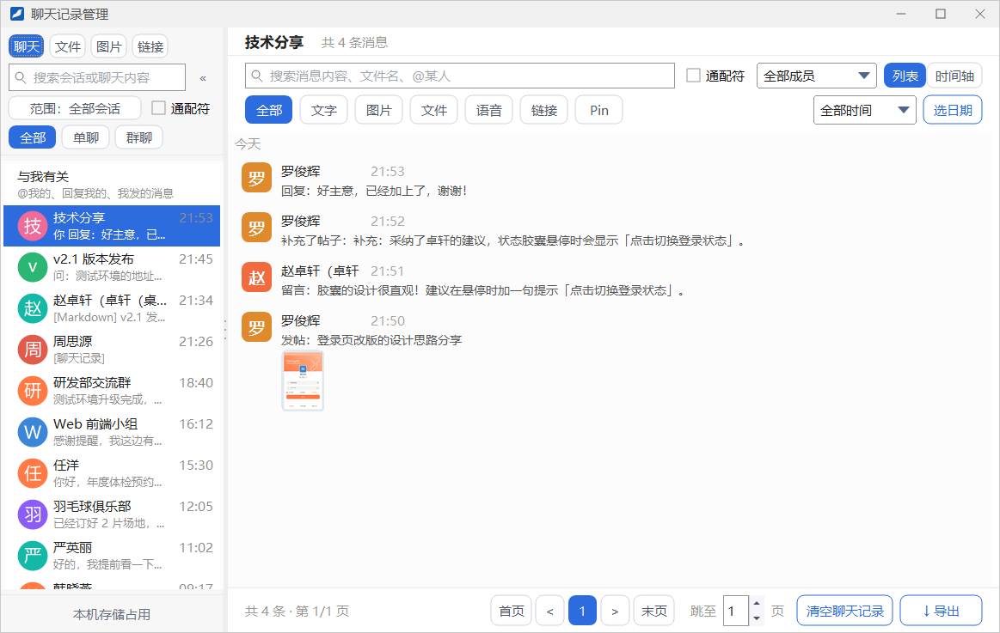<br>聊天记录管理器</td>
</tr>
<tr>
<td align="center">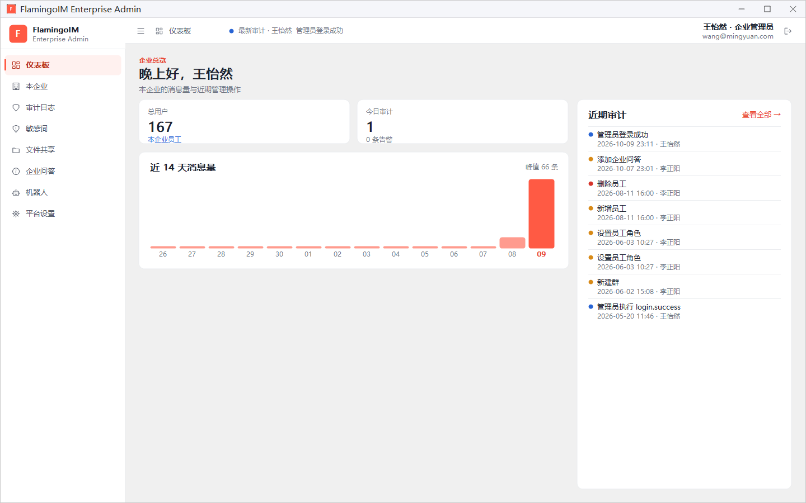<br>管理控制台：仪表板</td>
<td align="center">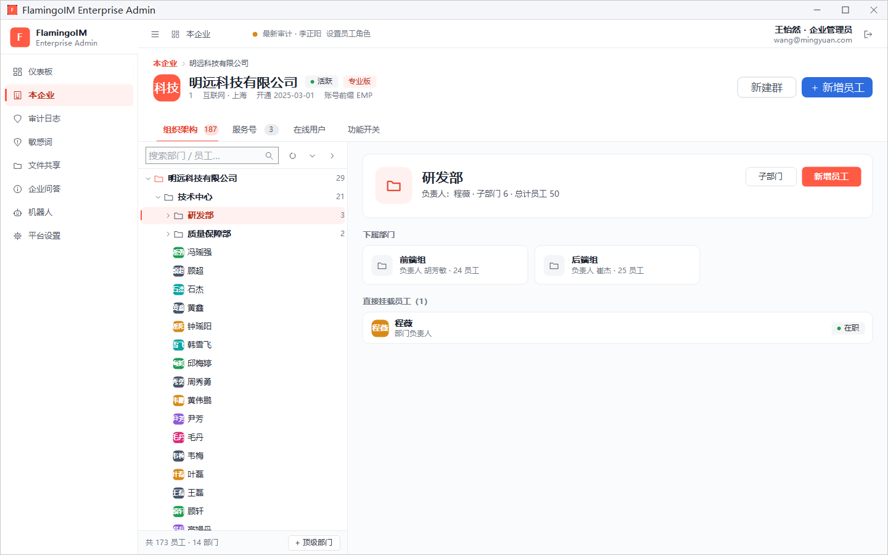<br>管理控制台：组织架构</td>
</tr>
</table>

## 整体架构

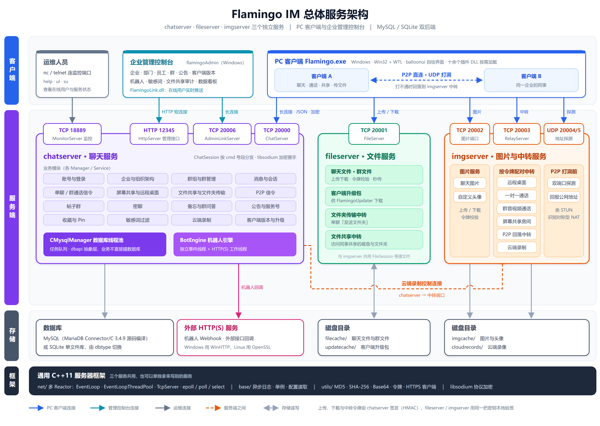

<details>
<summary>纯文本版</summary>

```
   PC 客户端（Flamingo.exe + 插件 DLL）                    管理控制台（flamingoAdmin.exe）
        │          │            │                               │             │
        │ 20000    │ 20001      │ 20002 / 20003                 │ 12345       │ 20006
        │ 聊天     │ 文件       │ 图片 / 实时数据中转            │ HTTP 接口   │ 在线用户推送
        ▼          ▼            ▼                               ▼             ▼
   ┌──────────┐ ┌──────────┐ ┌──────────┐              ┌─────────────────────────────┐
   │chatserver│ │fileserver│ │ imgserver│◄── UDP ──    │ chatserver（同一个进程）    │
   └────┬─────┘ └──────────┘ └──────────┘  20004/20005 └─────────────────────────────┘
        │                                  P2P 地址探测
        ▼
   MySQL 或 SQLite
```

</details>

两台客户端之间的 P2P 直连不经过服务器；建不起来时改走 imgserver 的中转端口。

## 仓库结构

| 目录 | 说明 |
| :--- | :--- |
| `flamingoserver/` | 服务端 |
| `flamingoclient/` | PC 客户端 |
| `flamingoAdmin/` | 管理控制台 |
| `third-party/` | PC 客户端与管理控制台用到的第三方库（opus、speexdsp、libsodium、sqlite、md4c）；其中 `balloonui/` 是独立仓库，需另行获取，见下文 |
| `docs/` | 协议、配置项与各功能的设计文档；`docs/help/` 是使用帮助 |
| `tools/` | 与具体工程无关的辅助脚本 |
| `bugs.md` | 已知问题清单 |
| `clean.ps1` | 一键清理仓库里可再生的垃圾文件与编译产物（`-DryRun` 只列出不删除） |

```
flamingoserver/
├── net/                    多 Reactor 网络框架、帧编解码与加密
├── base/                   单例、异步日志、配置文件读取
├── utils/                  MD5 / SHA-256 / Base64、口令哈希、令牌、HTTPS 客户端等通用工具
├── dbapi/                  数据库抽象层，业务代码只依赖这一层
├── mysqlapi/  sqliteapi/   MySQL 与 SQLite 两种后端的实现
├── mysqlmgr/               MySQL 建库建表与数据库工作线程
├── chatserversrc/          聊天服务：会话、协议分发、各业务模块
├── fileserversrc/          文件服务（imgserver 复用其中几个文件）
├── imgserversrc/           图片服务、实时数据中转、P2P 地址探测
├── tests/                  单元测试（doctest）
├── etc/                    三个服务的配置文件
├── deps/libsodium/         libsodium 预编译静态库
├── mariadb-connector-c-3.4.9/   MariaDB Connector/C 源码（上游原样，请勿修改）
├── zlib1.3.2/  sqlite3/  jsoncpp1.9.0/
├── windowsproj/            Visual Studio 工程
├── tools/                  建表语句生成、数据库维护与联调脚本
├── table_mysql.sql         数据库结构（唯一的权威来源）
└── table_sqlite.sql        由 table_mysql.sql 生成的 SQLite 建表语句

flamingoclient/
├── Source/                 主程序：App / Session / Common / Threading / net / UI / Feature，单元测试在 Tests/
├── Flamingo*/              13 个功能插件 DLL，见下文「PC 客户端」
├── FlamingoUpdater/        自动升级时负责解压安装包的更新器
├── deps/                   语音字幕识别引擎的构建脚本与模型准备脚本
├── tools/                  工程文件生成等辅助脚本
├── Debug/  Release/        x64 的运行目录，含图片、表情、声音与配置等资源
└── FlamingoClient.sln

flamingoAdmin/
├── Screens/  Widgets/  Shell/  Theme/  Util/   页面、控件、窗口外壳、配色与工具
├── FlamingoLink/           与服务端保持长连接、显示在线用户的 DLL
└── Tests/                  单元测试
```

## 快速开始

最省事的方式是让服务端使用 SQLite，不需要安装任何数据库服务。默认配置就是 SQLite。

```shell
# 1. 在 Linux 或 WSL 上编译服务端
cd flamingoserver
cmake -S . -B build-linux -DCMAKE_BUILD_TYPE=Release -DWITH_MYSQL=OFF
make -C build-linux -j$(nproc)

# 2. 启动三个服务（-d 表示以守护进程运行）
./build-linux/fileserver -d
./build-linux/imgserver  -d
./build-linux/chatserver -d
```

chatserver 首次启动时会自动建库建表，并创建：

- 一个默认企业 `FlamingoIM.org`，员工可以在客户端的注册窗口按这个公司名自助注册；
- 一个平台超级管理员，用于登录管理控制台：邮箱 `admin@flamingo.com`，密码 `admin123`。

> **部署前务必修改默认管理员。** 它由 `etc/chatserver.conf` 的 `defaultadminenable` / `defaultadminemail` / `defaultadminpassword` 控制，默认口令在源码仓库里是公开的；把 `defaultadminenable` 置 0 可以关闭这一行为。默认企业的名字由同一文件的 `defaultenterprise` 指定，必须与客户端 `flamingo.ini` 里 `[ui] defaultcompany` 的值一致，否则用预填的公司名注册会提示找不到公司。

然后获取 balloonui（见下文「PC 客户端」），用 Visual Studio 2022 打开 `flamingoclient/FlamingoClient.sln`，选 `Debug|x64` 编译，运行 `flamingoclient/Debug/Flamingo.exe` 即可连上本机的服务端。

## 服务端

### Linux 下编译

需要支持 C++11 的 g++ 与 CMake 3.12 以上。推荐像上面那样在 `build-linux/` 里做 out-of-source 构建，避免 CMake 的生成物与 `windowsproj/` 下的 Visual Studio 工程混在一起。

- `WITH_MYSQL`：MySQL 后端的编译开关，默认 `ON`。置为 `OFF` 时不编译 MySQL 客户端，只支持 `dbtype=sqlite`。需要连接 MySQL 时去掉该选项即可：MySQL 客户端（MariaDB Connector/C 3.4.9）随仓库以源码提供、编译时一并编出，只需安装 OpenSSL 的开发包（`libssl-dev` 或 `openssl-devel`）。
- `CMAKE_BUILD_TYPE`：默认是不优化的调试构建（`-O0 -g`），`Release` 为 `-O2 -g`。数据库操作多的请求两者相差可达十倍，部署时请用 `Release`。
- 机器上装有 OpenSSL 开发包时，机器人调用外部服务支持 HTTPS；没有时只支持 HTTP。

产物为 `build-linux/` 下的 `chatserver`、`fileserver`、`imgserver` 与测试程序 `flamingo_tests`（`WITH_MYSQL=ON` 时另有 `flamingo_tests_mysql`）。

### Windows 下编译

用 Visual Studio 2022 打开 `flamingoserver/FlamingoServer.sln`，选 `Debug|x64` 或 `Release|x64`（服务端只支持 64 位）。解决方案含 `chatserver`、`fileserver`、`imgserver`、`Tests` 与 MySQL 客户端静态库 `mariadbclient` 五个工程，产物在 `windowsproj/x64/Debug/` 或 `windowsproj/x64/Release/`。全部静态链接，产物只依赖 Windows 系统 DLL。

### 三个服务的分工

| 服务 | 用途 |
| :---: | :--- |
| chatserver | 注册登录、消息收发、组织架构、群组等核心业务；为管理控制台提供 HTTP 接口与在线用户推送；运行机器人引擎 |
| fileserver | 聊天文件、群文件的上传下载，以及客户端升级包的下载 |
| imgserver | 聊天图片与头像的上传下载；实时音视频、远程桌面等数据的中转；P2P 地址探测 |

### 数据库

由 `etc/chatserver.conf` 的 `dbtype` 选择后端（`WITH_MYSQL=OFF` 编译时只支持 SQLite）：

- **SQLite**：单文件库，路径由 `dbpath` 指定。相对路径以 chatserver 可执行文件所在的目录为基准，而不是工作目录，所以无论从哪里启动，打开的都是同一个库。
- **MySQL**：由 `dbserver` / `dbuser` / `dbpassword` / `dbname` 配置，首次启动自动建库。

`table_mysql.sql` 是数据库结构的唯一权威来源，只包含最终的建表语句。SQLite 的建表语句 `table_sqlite.sql` 与 `sqliteapi/SqliteSchema.cpp` 由 `tools/gen_table_sqlite.py` 从它生成，请勿手工编辑。

启动时只会建出缺少的表，**不会改动已有的表**。表结构有变化时，已有的库需要手工修改或重建：SQLite 库缺少某个建有索引的列时，chatserver 会启动失败；MySQL 库照常启动，用到缺失列的请求会出错。

### 配置、日志与启动

三个服务的配置文件是 `etc/chatserver.conf`、`etc/fileserver.conf`、`etc/imgserver.conf`，逐项说明见 [`docs/服务端配置项说明.md`](docs/服务端配置项说明.md)。每个服务从可执行文件所在的目录起逐级向上查找 `etc/`，所以可以从任意目录启动，`-d` 表示以守护进程方式运行。

日志写到配置项 `logfiledir` 指定的目录（默认 `logs/`，启动时自动创建）。相对路径同样以可执行文件所在的目录为基准，例如 Linux 构建写到 `build-linux/logs/`，Windows 构建写到 `windowsproj/x64/<配置>/logs/`。

### 端口

| 端口 | 协议 | 所属服务 | 用途 |
| :---: | :---: | :---: | :--- |
| 20000 | TCP | chatserver | 客户端聊天端口 |
| 18889 | TCP | chatserver | 监控端口 |
| 12345 | TCP | chatserver | HTTP 接口，供管理控制台使用 |
| 20006 | TCP | chatserver | 管理控制台的长连接，推送在线用户变化（配成 0 表示不监听） |
| 20001 | TCP | fileserver | 文件服务 |
| 20002 | TCP | imgserver | 图片服务 |
| 20003 | TCP | imgserver | 实时音视频、远程桌面等数据的中转 |
| 20004 / 20005 | UDP | imgserver | P2P 地址探测，须与 chatserver.conf 中的同名项一致 |

部署在 NAT 或云服务器安全组之后时，这些端口（包括两个 UDP 端口）都需要放行。

监控端口可以用 `nc` 或 `telnet` 连接查看服务器状态，支持 `help`、`ul`（在线用户列表）、`su [userid]`（查看指定用户）三个命令。

### 单元测试

服务端使用 doctest，测试代码在 `tests/`：

```shell
./build-linux/flamingo_tests                       # 全部用例
./build-linux/flamingo_tests --test-case="SHA*"    # 按用例名过滤
```

`flamingo_tests_mysql` 默认同样跑 SQLite；设置环境变量 `FLAMINGO_TEST_MYSQL=1` 后改连 MySQL（`FLAMINGO_TEST_MYSQL_HOST` / `_USER` / `_PWD` 指定连接参数，默认 `127.0.0.1` / `root` / `123456`），测试只会删除并重建名为 `flamingo_test_*` 的库。Windows 下编译 `Tests` 工程后运行 `windowsproj/x64/Debug/Tests.exe`。

## PC 客户端

### 第三方依赖

除自绘控件库 balloonui 外，客户端与控制台用到的第三方库都已包含在仓库的 `third-party/` 与 `flamingoAdmin/third-party/` 中。balloonui 是独立的 git 仓库，请把它克隆到 `third-party/balloonui/`：

```shell
git clone https://github.com/balloonwj/balloonui.git third-party/balloonui
```

语音字幕的识别引擎（sherpa-onnx，其中 onnxruntime 静态库近 1 GB）与识别模型体积太大，不放在仓库里，是可选的：

- 引擎：在 `flamingoclient/deps/sherpa-onnx/` 下运行一次 `build_sherpa_onnx.ps1`（需要 git、CMake 与外网，每个平台约 20～30 分钟）。
- 模型：运行 `flamingoclient/deps/caption-model/prepare_model.py`。

没有它们时客户端照样能编译运行，只是字幕功能提示引擎不可用。

### 工程

`flamingoclient/FlamingoClient.sln` 包含主程序、13 个功能插件 DLL 与几个辅助工程。插件 DLL 由主程序在启动时或首次使用时加载，某个插件缺失或加载失败时，对应功能的入口会被隐藏，其余功能不受影响。

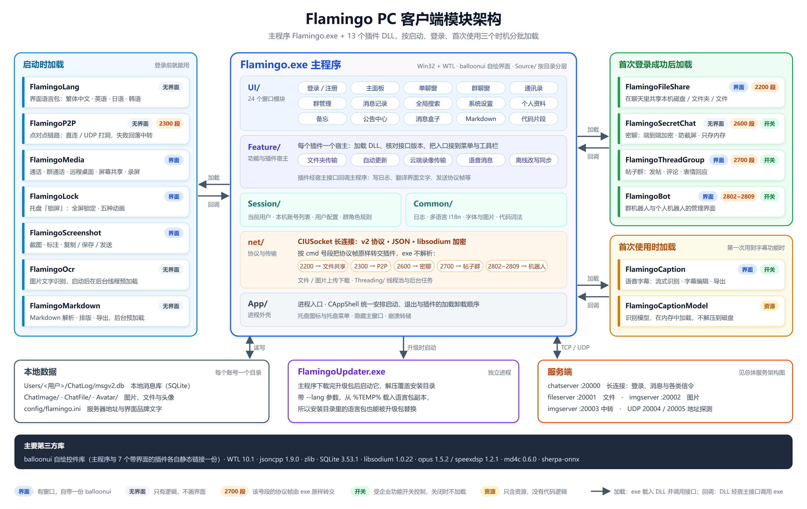

| 工程 | 说明 |
| :--- | :--- |
| `Flamingo` | 主程序 |
| `FlamingoMedia` | 一对一与群音视频通话、远程桌面、屏幕共享、屏幕录制 |
| `FlamingoP2P` | 两台客户端之间的 P2P 连接（局域网直连、UDP 打洞，失败时回退到服务器中转） |
| `FlamingoFileShare` | 文件共享 |
| `FlamingoSecretChat` | 密聊 |
| `FlamingoThreadGroup` | 帖子群 |
| `FlamingoBot` | 群机器人与个人机器人的管理界面 |
| `FlamingoMarkdown` | Markdown 解析、排版、绘制与导出 |
| `FlamingoScreenshot` | 截图 |
| `FlamingoOcr` | 图片文字识别（使用 Windows 10 自带的识别引擎） |
| `FlamingoCaption` | 语音字幕：实时识别、字幕编辑器与导出 |
| `FlamingoCaptionModel` | 只含语音识别模型的资源 DLL |
| `FlamingoLock` | 锁屏 |
| `FlamingoLang` | 界面语言包（繁體中文、English、日本語、한국어） |
| `FlamingoUpdater` | 自动升级时负责解压安装包的更新器 |
| `FlamingoUnit` | 客户端单元测试（Catch2） |
| `balloonui_static` | 自绘控件库 |
| `opus_static` / `speexdsp_static` | 音频编解码与回声消除 |

### 编译配置与输出目录

**`Debug|x64` 是首选配置。** 四个配置的输出目录如下：

| 配置 | 输出目录 | 能否直接运行 |
| :--- | :--- | :--- |
| `Debug\|x64` | `flamingoclient/Debug/` | 可以，资源齐全 |
| `Release\|x64` | `flamingoclient/Release/` | 可以，资源齐全 |
| `Debug\|Win32` | `flamingoclient/Debug_Win32/` | 否，只有编译产物 |
| `Release\|Win32` | `flamingoclient/Release_Win32/` | 否，只有编译产物 |

32 位产物的目录里没有图片、声音、配置等资源，需要运行时请把 exe 复制到 `Debug/` 下改名后再启动。

### 运行与配置

服务器地址、端口、心跳等运行期配置在运行目录的 `config/flamingo.ini` 中，默认指向 `127.0.0.1`。**该文件必须保持 ASCII 编码**，写入非 ASCII 字符会导致界面文字乱码。只有 `[ui]` 节的 `apptitle`（产品名）、`slogan`、`copyrighttext`、`defaultcompany` 四项例外，可以写中文（UTF-8 或 ANSI 均可）。

把客户端换成自己公司的品牌，改 `[ui]` 节的前三项，保存后重启客户端即可：

```ini
[ui]
apptitle=示例科技
slogan=高效沟通，安心协作
copyrighttext=© 2026 示例科技有限公司
```

- `apptitle`：产品名。主面板与各窗口、提示框的标题栏，登录窗与注册窗的品牌大字，「关于 示例科技」「退出 示例科技」这类文字，以及自动升级程序的提示框，都显示这个名字。不配置或留空时为 `FlamingoIM`。
- `slogan`：登录窗、注册窗与「关于」对话框里产品名下方的标语。去掉这一项使用内置标语，写成 `slogan=`（等号后面什么都不写）则不显示标语。
- `copyrighttext`：「关于」对话框底部的版权文字。不配置或留空时使用内置的版权行。

注释行与其余各项仍须保持 ASCII。

界面语言记录在 `[ui] language`，取值为 `zh-CN`、`zh-TW`、`en-US`、`ja-JP`、`ko-KR` 之一。一般在界面上切换即可，不需要手改。删掉这一项或留空时，客户端跟随 Windows 的显示语言：中文（台湾、香港、澳门）用繁體中文，英文、日文、韩文系统用对应语言，其余用简体中文。仓库附带的 `flamingo.ini` 写的是 `language=zh-CN`，想让客户端跟随系统语言，把这一行删掉即可。译文在独立的 `FlamingoLang.dll` 里，缺少这个 DLL 时界面为简体中文，语言入口也会隐藏。

客户端的本地数据（聊天记录库、图片、文件、头像缓存等）按账号存放在 `Users/<账号>/` 下，默认位于运行目录，可以在系统设置的「存储」页里修改位置。

### 调试入口

主程序支持一组命令行参数，用模拟数据直接打开某个窗口，便于调试界面，例如：

```shell
Flamingo.exe --mainpanel       # 主面板
Flamingo.exe --chatwindow      # 单聊窗口
Flamingo.exe --groupmanage     # 群管理
Flamingo.exe --history         # 消息记录
```

完整列表见 `Source/App/DebugEntryPoints.cpp`。

### 单元测试

客户端使用 Catch2，测试代码在 `Source/Tests/` 与各插件的 `Tests/` 目录。编译 `FlamingoUnit` 工程后运行输出目录下的 `Tests/FlamingoUnit.exe`，可以按标签过滤，多个标签写成一个参数，例如 `FlamingoUnit.exe "[contact],[favorites]"`；`"~[live]"` 跳过需要连接真实服务器的用例。

## 管理控制台

`flamingoAdmin/` 通过 chatserver 的 HTTP 端口（默认 12345）管理企业与员工，接口文档见 [`docs/Admin控制台接口文档.md`](docs/Admin控制台接口文档.md)；「在线用户」页通过 20006 端口的长连接实时刷新。

用 Visual Studio 2022 打开 `flamingoAdmin/flamingoAdmin.sln`，选 `Debug|x64` 编译。解决方案含 `flamingoAdmin`、`FlamingoLink`、`flamingoAdminTests`、`balloonui_static` 四个工程，产物都在 `flamingoAdmin/Bin/x64/`：

| 产物 | 说明 |
| :--- | :--- |
| `flamingoAdmin.exe` | 管理控制台 |
| `FlamingoLink.dll` | 长连接与「在线用户」页 |
| `flamingoAdminTests.exe` | 单元测试，直接运行，结束时打印通过与失败数 |

控制台没有模拟数据，需要先启动 chatserver 才能登录，登录账号见上文「快速开始」。

## 文档

`docs/` 下的主要文档：

| 文档 | 内容 |
| :--- | :--- |
| [使用帮助](docs/help/help.md) | 客户端、企业管理员与平台管理员的图文使用说明（网页版为 `docs/help/index.html`） |
| [协议设计-v2](docs/协议设计-v2.md) | v2 协议的命令号、错误码与每条命令的请求、应答 JSON 示例（权威文档） |
| [协议加密方案](docs/协议加密方案.md) | 握手、密钥交换与帧加密 |
| [服务端配置项说明](docs/服务端配置项说明.md) | 三个服务配置文件的逐项说明 |
| [Admin控制台接口文档](docs/Admin控制台接口文档.md) | 管理控制台使用的 HTTP 接口 |
| [SQLite本地数据库模式方案](docs/SQLite本地数据库模式方案.md) | SQLite 后端的设计 |
| [服务端依赖库源码编译方案](docs/服务端依赖库源码编译方案.md) | MariaDB Connector/C、zlib 与 libsodium 的编译与集成 |
| [git代码提交规范及简明教程](docs/git代码提交规范及简明教程.md) | 提交规范 |

各功能的设计方案按主题分：

- **消息与会话**：[聊天消息转发](docs/聊天消息转发方案.md)、[撤回后重新编辑](docs/撤回后重新编辑方案.md)、[消息Pin](docs/消息Pin接入方案.md)、[收藏](docs/收藏接入方案.md)、[快捷回复](docs/快捷回复方案.md)、[语音消息](docs/语音消息方案.md)、[代码片段](docs/代码片段方案.md)、[Markdown消息](docs/Markdown消息方案.md)、[消息提醒模式与消息盒子（含特别关注）](docs/消息提醒模式与消息盒子方案.md)、[会话标为未读](docs/会话标为未读方案.md)、[消息改写离线同步](docs/消息改写离线同步方案.md)、[清理聊天记录](docs/清理聊天记录方案.md)、[聊天消息时间显示](docs/聊天消息时间显示方案.md)、[公告中心](docs/公告中心接入方案.md)
- **聊天记录与搜索**：[聊天记录管理器](docs/聊天记录管理器方案.md)、[消息记录界面优化](docs/消息记录界面优化方案.md)、[消息记录内容交互](docs/消息记录内容交互方案.md)、[全局搜索增强](docs/全局搜索增强方案.md)、[本地消息库写入性能优化](docs/本地消息库写入性能优化方案.md)、[会话列表拉取性能优化](docs/会话列表拉取性能优化方案.md)
- **群组**：[群管理](docs/群管理接入方案.md)、[群公告](docs/群公告接入方案.md)、[群聊@提醒](docs/群聊@提醒方案.md)、[邀请入群](docs/邀请入群方案.md)、[群成员部门树](docs/群成员部门树方案.md)、[群接龙](docs/群接龙方案.md)、[群问答](docs/群问答方案.md)、[帖子群](docs/帖子群方案.md)
- **通讯录与账号**：[联系人资料字段扩充](docs/联系人资料字段扩充方案.md)、[联系人标签](docs/联系人标签接入方案.md)、[登录账号与手机号登录](docs/登录账号与手机号登录方案.md)、[自动登录](docs/自动登录方案.md)、[无操作自动离开](docs/无操作自动离开方案.md)
- **文件与传输**：[单聊文件夹传输](docs/单聊文件夹传输方案.md)、[单聊文件P2P直传与P2P徽章](docs/单聊文件P2P直传与P2P徽章方案.md)、[P2P通信](docs/P2P通信方案.md)、[文件共享](docs/文件共享方案.md)
- **音视频与屏幕**：[音视频通话](docs/音视频通话方案.md)、[音视频通话优化](docs/音视频通话优化方案.md)、[媒体切换](docs/音视频通话-媒体切换方案.md)、[界面美化](docs/音视频通话-界面美化方案.md)、[网络状况标识](docs/音视频通话-网络状况标识方案.md)、[群音视频通话](docs/群音视频通话方案.md)、[屏幕共享与录制](docs/屏幕共享与录制方案.md)、[语音字幕](docs/语音字幕方案.md)、[聊天字幕模式](docs/聊天字幕模式方案.md)、[屏幕墙（方案，尚未实现）](docs/屏幕墙方案.md)
- **客户端工具与系统**：[截图独立模块](docs/截图独立模块方案.md)、[截图快捷键与隐藏当前窗口](docs/截图快捷键与隐藏当前窗口方案.md)、[图片文字识别](docs/图片文字识别方案.md)、[密聊](docs/密聊方案.md)、[备忘与提醒](docs/备忘与提醒方案.md)、[锁屏](docs/锁屏方案.md)、[多语言](docs/多语言方案.md)、[客户端自动更新](docs/客户端自动更新方案.md)、[本地数据存储位置与缓存清理](docs/本地数据存储位置与缓存清理方案.md)、[崩溃转储](docs/崩溃转储方案.md)、[禁止机器休眠](docs/禁止机器休眠方案.md)、[登录注册窗口翻转切换](docs/登录注册窗口翻转切换.md)
- **机器人与企业管理**：[机器人](docs/机器人方案.md)、[仓库变动通知](docs/仓库变动通知方案.md)、[敏感词](docs/敏感词方案.md)、[FlamingoLink](docs/FlamingoLink方案.md)
- **开发规范与排查记录**：[客户端窗口消息号段规约与整改](docs/客户端窗口消息号段规约与整改方案.md)、[界面自动化验证原理](docs/界面自动化验证原理.md)、[主面板被其它窗口盖住问题排查](docs/主面板被其它窗口盖住问题排查.md)

已知但尚未修复的问题记录在仓库根目录的 [`bugs.md`](bugs.md)。

## 更新日志

由于平常工作比较忙，不能固定周期地更新 Flamingo，但我保证我会一直维护下去。更新日志请参见：

[Flamingo 更新日志](https://github.com/baloonwj/flamingo/issues/1)

## BUG 反馈

如果您在使用的过程中发现任何 bug，可以给我发邮件：balloonwj@qq.com，也可以去 bug 反馈页面进行反馈：

https://github.com/baloonwj/flamingo/issues/5

凡是涉及到崩溃、死机等影响使用的重大 bug，我将在三个工作日内予以解决；其他不影响使用的功能性 bug，两个星期内解决。

## 联系方式

如果您在使用这个项目的过程中遇到任何问题，或者您对我的项目有任何意见或者建议，再或者有不错的想法欢迎与我交流，可以加 **Flamingo 微信技术交流群**：先加微信 **easy_coder** 备注“flamingo”，我会邀请你进群。备用 QQ 技术群：**729995516**。
