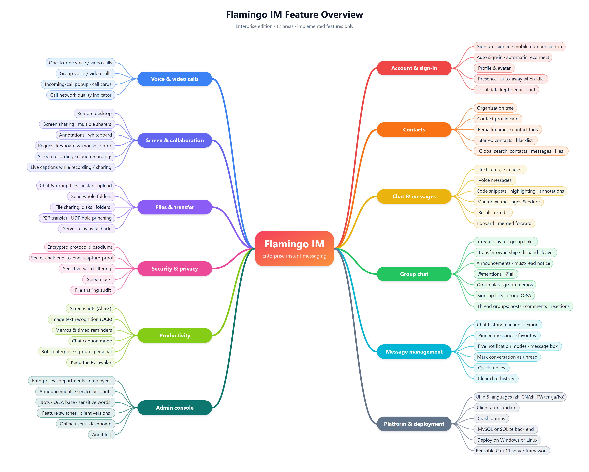
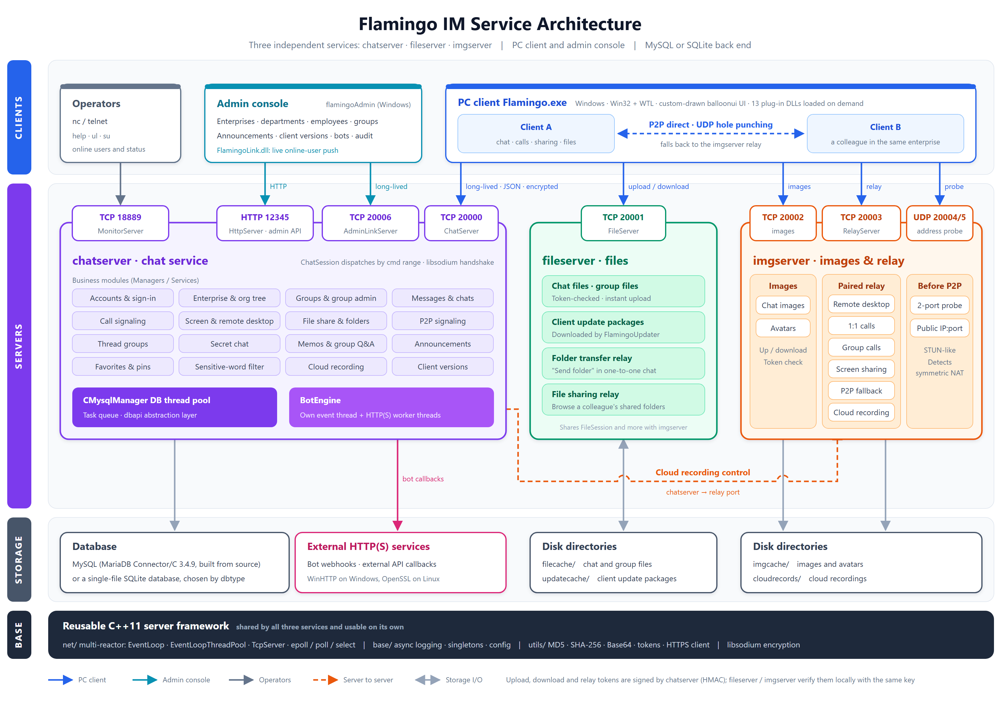
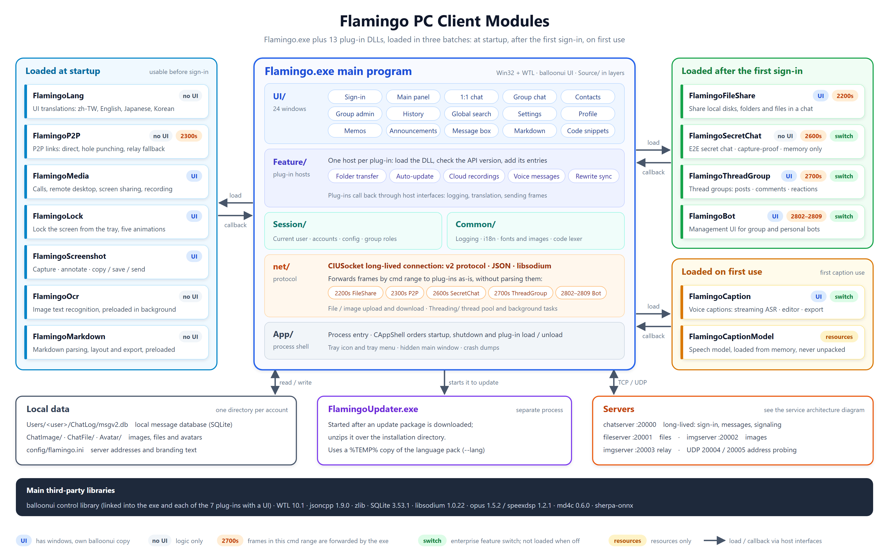

# FlamingoIM

[阅读中文版](README.md)

## Introduction

FlamingoIM is an open-source enterprise instant messaging system written in C++ from top to bottom: the network library, the protocol, the server, the desktop client and the admin console. The network library, the protocol and the UI control library are all its own; it uses no large framework such as Boost, Qt, Electron or a browser engine. It has three parts:

- **Server** (`flamingoserver/`): written in C++11, builds and runs on Linux and Windows, and produces three services: `chatserver`, `fileserver` and `imgserver`. Underneath is its own Muduo-style multi-reactor network library, asynchronous logging and database access layer; this code is a reusable server framework in its own right and a good way to study high-performance server development. The database is SQLite by default, so it runs without installing any database service, and one config option switches it to MySQL. All dependencies ship with the repository, and the Windows build depends only on DLLs that come with Windows.
- **PC client** (`flamingoclient/`): a native Windows desktop program (Win32 + WTL) whose UI is drawn by the custom-drawn control library balloonui. Besides the main executable there are 13 plug-in DLLs: audio/video, file sharing, secret chat, thread groups, screenshots, text recognition, voice captions, screen lock and other features each live in their own DLL and are loaded on demand. If a DLL is missing, only the entries of that feature are hidden and everything else keeps working. The UI comes in 5 languages, and the client updates itself after an administrator publishes a new version.
- **Admin console** (`flamingoAdmin/`): a Windows desktop program. Enterprise administrators use it to maintain the organization structure and employees, turn features on or off per enterprise, configure sensitive words, enterprise bots and enterprise Q&A, and view the audit log and online users; platform operators use it to manage multiple enterprises and publish platform announcements and new client versions.

Beyond the basics of one-to-one chat, group chat, images and files, FlamingoIM covers the real-time communication and remote collaboration that enterprises use every day: one-to-one and group voice/video calls, remote desktop, screen sharing with annotations and a whiteboard, and local and cloud screen recording. Two clients connect peer-to-peer whenever they can and go through the server relay only when they cannot. Voice captions are recognised offline on the local machine (mixed Chinese and English, with automatic punctuation), and image text recognition uses the engine built into Windows, so none of this data has to be sent to a cloud service. On the security side, all traffic between client and server is encrypted (X25519 key exchange + XChaCha20-Poly1305); secret chat adds end-to-end encryption on top, keeps messages in memory only and prevents the chat window from being captured.

This repository is the **enterprise edition**. The contact directory comes straight from the enterprise organization structure: colleagues in the same enterprise can see and message each other without "adding a friend" first, so there are no friend requests or friend groups.

The project comes with thorough tests and documentation: more than 1,300 doctest unit test cases for the server and more than 5,000 Catch2 cases for the client; over 70 protocol and feature design documents under `docs/`, plus a 44-chapter illustrated [user guide](docs/help/help.md) (in Chinese).

## Features

The full illustrated user guide is in the [help](docs/help/help.md) (in Chinese; you can also open [`docs/help/index.html`](docs/help/index.html) in a browser for the web version).



### PC client

**Account and UI**

- Sign in with an account name or a mobile number, remember the password and sign in automatically, self-registration by company name
- Presence status; switches to "away" automatically after a period of inactivity
- Multilingual UI: Simplified Chinese, Traditional Chinese, English, Japanese, Korean. Switch from the bottom-right corner of the sign-in window or under Settings → General → Language (takes effect after a restart), or let it follow the Windows display language. The UI font changes with the language, plug-in windows and the updater are translated too, and group system notices (someone left the group, ownership was transferred and so on) are shown in each member's own UI language (see [Running and configuration](#running-and-configuration))
- Screen lock: lock the whole screen behind a temporary password, with five lock-screen animations
- Automatic updates: after an administrator publishes a new version in the console, the client prompts, then downloads and installs it
- Your own branding: the product name in the title bars can be changed to your company's name; the main panel and every window and message box title, the big name in the sign-in and register windows, and texts such as "About" / "Exit" all follow it. The slogan and the copyright line of the About dialog can be replaced too. It is a config-file change only: no code changes, no rebuild (see [Running and configuration](#running-and-configuration))

**Contacts and conversations**

- Enterprise organization tree as the contact directory; contact profiles (job title, desk phone, adjustable visibility of mobile and desk phone numbers)
- Contact remark names, contact tags, favorites
- Pin conversations, mark as unread; per-conversation notification setting: normal, do not disturb, fold into the message box, starred; group chats can also be blocked or set to notify only for @me and followed members
- Message box and announcement center for platform announcements
- Global search across contacts, groups, local chat history and chat history on the server

**Chat**

- Text, emoji, font settings, window shake, images, files, folders
- Voice messages
- Code snippets with syntax colouring and annotations on selected code
- Markdown documents: a standalone editor; received documents are shown as cards and can be exported to `.md`, `.html`, `.png`, `.pdf` and `.docx`
- Recall and re-edit, quoted replies, pinning, multi-select delete, forwarding one by one or as a merged record, quick replies
- Screenshots (global hotkey, annotations) and image text recognition (OCR)
- Secret chat: end-to-end encrypted; messages are kept in memory only, never written to the local database, and the chat window cannot be captured by screenshots

**Groups**

- Group chat, @mentions, group files, group announcements (including must-read ones), group memos, group Q&A, sign-up lists
- Invitations, group links, join approval, muting, administrators and group permissions, transferring ownership, disbanding and leaving
- Thread groups: no chat stream, only posts, with addenda, two-level comments and emoji reactions
- Bots: personal bots (auto-reply on your behalf) and group bots (keyword rules, pushes from external systems)

**Audio, video and screen**

- One-to-one voice and video calls; group voice and video calls
- Remote desktop
- Screen sharing: annotations, whiteboard, requesting control of the sharer's keyboard and mouse, multiple sharers (approved by the host), password and share links
- Screen recording: local recordings and cloud recordings
- Voice captions: live captions while recording or sharing the screen, a caption editor, export as an MP4 with burned-in captions, an MP4 with a caption track, or SRT; caption mode for chat windows
- Two online clients connect peer-to-peer when they can (LAN direct or UDP hole punching) and fall back to the server relay otherwise

**Productivity**

- File sharing: share a local disk, folder or file into a conversation so its members can browse, download and upload
- Memos and reminders; save chat messages as memos
- Chat history manager: cross-conversation search, timeline, file and image libraries, local storage usage, export
- Settings: notifications, hotkeys, audio and video devices, local data location and cache cleanup

### Admin console

The console has two administrator roles:

- **Enterprise administrator**: dashboard, organization and employees, service accounts, creating groups for departments, online users, feature switches, sensitive words, file share management and audit, enterprise Q&A, enterprise bots, audit log.
- **Platform super administrator**: platform overview, enterprise management (create, review, suspend, delete), platform announcements, client version publishing and automatic updates.

### Server

- Muduo-style multi-reactor network framework (epoll on Linux, select on Windows)
- v2 protocol: a binary frame header plus a JSON body; larger bodies are compressed with zlib. After connecting, X25519 key exchange and XChaCha20-Poly1305 encryption of every frame body (libsodium)
- Two database back ends, MySQL and SQLite, chosen by a config option in the same binary; the database and tables are created automatically on first start
- Relay for real-time audio/video, remote desktop and similar data, and UDP address probing for P2P connections
- HTTP API for the admin console, plus a long-lived connection that pushes online-user changes
- Bot engine (rule replies, webhooks, calls to external HTTPS services), sensitive-word filtering, offline sync of messages rewritten after they were sent
- All dependencies ship with the repository: MariaDB Connector/C and zlib are built from source, libsodium is a prebuilt static library; the Windows binaries depend on Windows system DLLs only

## Screenshots

The screenshots are taken from the [help](docs/help/help.md); all names and data are demo data.

<table>
<tr>
<td align="center"><br>Main panel (organization directory)</td>
<td align="center"><br>One-to-one chat</td>
</tr>
<tr>
<td align="center"><br>Group chat</td>
<td align="center"><br>Thread group</td>
</tr>
<tr>
<td align="center"><br>Markdown editor</td>
<td align="center"><br>Group voice call</td>
</tr>
<tr>
<td align="center"><br>Caption editor</td>
<td align="center"><br>Chat history manager</td>
</tr>
<tr>
<td align="center"><br>Admin console: dashboard</td>
<td align="center"><br>Admin console: organization</td>
</tr>
</table>

## Architecture



<details>
<summary>Plain-text version</summary>

```
   PC client (Flamingo.exe + plug-in DLLs)                 Admin console (flamingoAdmin.exe)
        │          │            │                               │             │
        │ 20000    │ 20001      │ 20002 / 20003                 │ 12345       │ 20006
        │ chat     │ files      │ images / real-time relay      │ HTTP API    │ online-user push
        ▼          ▼            ▼                               ▼             ▼
   ┌──────────┐ ┌──────────┐ ┌──────────┐              ┌─────────────────────────────┐
   │chatserver│ │fileserver│ │ imgserver│◄── UDP ──    │ chatserver (same process)   │
   └────┬─────┘ └──────────┘ └──────────┘  20004/20005 └─────────────────────────────┘
        │                                  P2P address probing
        ▼
   MySQL or SQLite
```

</details>

A P2P connection between two clients does not pass through the server; when one cannot be set up, the data goes through imgserver's relay port instead.

## Repository layout

| Directory | Contents |
| :--- | :--- |
| `flamingoserver/` | Server |
| `flamingoclient/` | PC client |
| `flamingoAdmin/` | Admin console |
| `third-party/` | Third-party libraries used by the PC client and the admin console (opus, speexdsp, libsodium, sqlite, md4c); `balloonui/` inside it is a separate repository that you fetch yourself, see below |
| `docs/` | Protocol, configuration and feature design documents (in Chinese); `docs/help/` is the user guide |
| `tools/` | Helper scripts not tied to one project |
| `bugs.md` | Known issues |
| `clean.ps1` | Removes regenerable junk files and build outputs from the whole repository (`-DryRun` only lists them) |

```
flamingoserver/
├── net/                    multi-reactor network framework, frame codec and encryption
├── base/                   singletons, asynchronous logging, config file reader
├── utils/                  MD5 / SHA-256 / Base64, password hashing, tokens, HTTPS client and other helpers
├── dbapi/                  database abstraction layer; business code depends only on this
├── mysqlapi/  sqliteapi/   the MySQL and SQLite back ends
├── mysqlmgr/               MySQL database/table creation and database worker threads
├── chatserversrc/          chat service: sessions, protocol dispatch, business modules
├── fileserversrc/          file service (imgserver reuses a few of these files)
├── imgserversrc/           image service, real-time relay, P2P address probing
├── tests/                  unit tests (doctest)
├── etc/                    config files of the three services
├── deps/libsodium/         prebuilt libsodium static libraries
├── mariadb-connector-c-3.4.9/   MariaDB Connector/C source (upstream as-is, do not edit)
├── zlib1.3.2/  sqlite3/  jsoncpp1.9.0/
├── windowsproj/            Visual Studio projects
├── tools/                  schema generation, database maintenance and test scripts
├── table_mysql.sql         database schema (the single authoritative source)
└── table_sqlite.sql        SQLite schema generated from table_mysql.sql

flamingoclient/
├── Source/                 main program: App / Session / Common / Threading / net / UI / Feature; unit tests in Tests/
├── Flamingo*/              13 feature plug-in DLLs, see "PC client" below
├── FlamingoUpdater/        updater that unpacks the update package during automatic updates
├── deps/                   build script for the speech recognition engine and model preparation script
├── tools/                  project file generators and other helpers
├── Debug/  Release/        x64 run directories with images, emoji, sounds, configuration and other resources
└── FlamingoClient.sln

flamingoAdmin/
├── Screens/  Widgets/  Shell/  Theme/  Util/   pages, controls, window shell, colours and utilities
├── FlamingoLink/           DLL that keeps a long-lived connection to the server and shows online users
└── Tests/                  unit tests
```

## Quick start

The easiest way is to run the server on SQLite, which needs no database service. The default configuration already uses SQLite.

```shell
# 1. Build the server on Linux or WSL
cd flamingoserver
cmake -S . -B build-linux -DCMAKE_BUILD_TYPE=Release -DWITH_MYSQL=OFF
make -C build-linux -j$(nproc)

# 2. Start the three services (-d runs them as daemons)
./build-linux/fileserver -d
./build-linux/imgserver  -d
./build-linux/chatserver -d
```

On first start, chatserver creates the database and tables, plus:

- a default enterprise `FlamingoIM.org`, which employees can join through self-registration in the client by entering this company name;
- a platform super administrator for signing in to the admin console: e-mail `admin@flamingo.com`, password `admin123`.

> **Change the default administrator before deploying.** It is controlled by `defaultadminenable` / `defaultadminemail` / `defaultadminpassword` in `etc/chatserver.conf`, and the default password is public in this repository; set `defaultadminenable` to 0 to turn the behaviour off. The default enterprise's name comes from `defaultenterprise` in the same file and must equal `[ui] defaultcompany` in the client's `flamingo.ini`; otherwise registering with the pre-filled company name fails with "company not found".

Then fetch balloonui (see "PC client" below), open `flamingoclient/FlamingoClient.sln` in Visual Studio 2022, build `Debug|x64`, and run `flamingoclient/Debug/Flamingo.exe`; it connects to the server on the local machine.

## Server

### Building on Linux

You need a g++ with C++11 support and CMake 3.12 or later. Build out of source in `build-linux/` as shown above, so that CMake's output does not mix with the Visual Studio projects under `windowsproj/`.

- `WITH_MYSQL`: switch for the MySQL back end, `ON` by default. With `OFF`, the MySQL client is not built and only `dbtype=sqlite` is supported. To connect to MySQL, just drop the option: the MySQL client (MariaDB Connector/C 3.4.9) ships as source and is built along with the server; you only need the OpenSSL development package (`libssl-dev` or `openssl-devel`).
- `CMAKE_BUILD_TYPE`: the default is an unoptimised debug build (`-O0 -g`); `Release` gives `-O2 -g`. Database-heavy requests can differ by a factor of ten, so deploy a `Release` build.
- When the OpenSSL development package is installed, bots can call external services over HTTPS; without it, only HTTP.

The outputs are `chatserver`, `fileserver`, `imgserver` and the test program `flamingo_tests` in `build-linux/` (plus `flamingo_tests_mysql` when `WITH_MYSQL=ON`).

### Building on Windows

Open `flamingoserver/FlamingoServer.sln` in Visual Studio 2022 and choose `Debug|x64` or `Release|x64` (the server is 64-bit only). The solution has five projects: `chatserver`, `fileserver`, `imgserver`, `Tests` and the MySQL client static library `mariadbclient`. The outputs go to `windowsproj/x64/Debug/` or `windowsproj/x64/Release/`. Everything is linked statically, so the binaries depend on Windows system DLLs only.

### What each service does

| Service | Purpose |
| :---: | :--- |
| chatserver | Core business: registration and sign-in, messaging, organization structure, groups; the HTTP API and online-user push for the admin console; the bot engine |
| fileserver | Upload and download of chat files and group files, and download of client update packages |
| imgserver | Upload and download of chat images and avatars; relay for real-time audio/video, remote desktop and similar data; P2P address probing |

### Database

`dbtype` in `etc/chatserver.conf` selects the back end (a `WITH_MYSQL=OFF` build supports SQLite only):

- **SQLite**: a single-file database whose path is `dbpath`. A relative path is resolved against the directory of the chatserver executable, not the working directory, so the same database is opened wherever you start it from.
- **MySQL**: configured by `dbserver` / `dbuser` / `dbpassword` / `dbname`; the database is created on first start.

`table_mysql.sql` is the single authoritative source of the schema and contains only the final `CREATE TABLE` statements. The SQLite schema `table_sqlite.sql` and `sqliteapi/SqliteSchema.cpp` are generated from it by `tools/gen_table_sqlite.py`; do not edit them by hand.

At startup only missing tables are created; **existing tables are never altered**. After a schema change, alter or rebuild existing databases by hand: an SQLite database that lacks an indexed column makes chatserver fail to start, while a MySQL database starts normally and requests that use the missing column fail.

### Configuration, logs and startup

The three services read `etc/chatserver.conf`, `etc/fileserver.conf` and `etc/imgserver.conf`; every option is described in [`docs/服务端配置项说明.md`](docs/服务端配置项说明.md) (in Chinese). Each service looks for `etc/` starting from the directory of its executable and walking up, so it can be started from any directory. `-d` runs it as a daemon.

Logs go to the directory named by `logfiledir` (default `logs/`, created at startup). A relative path is again resolved against the executable's directory: the Linux build writes to `build-linux/logs/`, the Windows build to `windowsproj/x64/<configuration>/logs/`.

### Ports

| Port | Protocol | Service | Purpose |
| :---: | :---: | :---: | :--- |
| 20000 | TCP | chatserver | client chat port |
| 18889 | TCP | chatserver | monitor port |
| 12345 | TCP | chatserver | HTTP API for the admin console |
| 20006 | TCP | chatserver | long-lived connection of the admin console that pushes online-user changes (0 means not listening) |
| 20001 | TCP | fileserver | file service |
| 20002 | TCP | imgserver | image service |
| 20003 | TCP | imgserver | relay for real-time audio/video, remote desktop and similar data |
| 20004 / 20005 | UDP | imgserver | P2P address probing; must match the options of the same name in chatserver.conf |

Behind NAT or a cloud security group, all of these ports, including the two UDP ports, must be opened.

You can connect to the monitor port with `nc` or `telnet` to inspect the server. It supports three commands: `help`, `ul` (online user list) and `su [userid]` (show one user).

### Unit tests

The server uses doctest; the tests are in `tests/`:

```shell
./build-linux/flamingo_tests                       # all test cases
./build-linux/flamingo_tests --test-case="SHA*"    # filter by test case name
```

`flamingo_tests_mysql` also runs on SQLite by default. With the environment variable `FLAMINGO_TEST_MYSQL=1` it connects to MySQL instead (`FLAMINGO_TEST_MYSQL_HOST` / `_USER` / `_PWD` give the connection parameters, default `127.0.0.1` / `root` / `123456`); the tests only drop and recreate databases named `flamingo_test_*`. On Windows, build the `Tests` project and run `windowsproj/x64/Debug/Tests.exe`.

## PC client

### Third-party dependencies

Apart from the balloonui control library, every third-party library the client and the admin console need is already in the repository under `third-party/` and `flamingoAdmin/third-party/`. balloonui is a separate git repository; clone it into `third-party/balloonui/`:

```shell
git clone https://github.com/balloonwj/balloonui.git third-party/balloonui
```

The speech recognition engine for voice captions (sherpa-onnx, whose onnxruntime static library alone is close to 1 GB) and the recognition model are too large for the repository and are optional:

- Engine: run `build_sherpa_onnx.ps1` once in `flamingoclient/deps/sherpa-onnx/` (needs git, CMake and Internet access; about 20–30 minutes per platform).
- Model: run `flamingoclient/deps/caption-model/prepare_model.py`.

Without them the client still builds and runs; the caption features just report that the engine is unavailable.

### Projects

`flamingoclient/FlamingoClient.sln` contains the main program, 13 feature plug-in DLLs and a few helper projects. The main program loads each plug-in DLL at startup or on first use; if one is missing or fails to load, the entries of that feature are hidden and everything else keeps working.



| Project | Purpose |
| :--- | :--- |
| `Flamingo` | main program |
| `FlamingoMedia` | one-to-one and group audio/video calls, remote desktop, screen sharing, screen recording |
| `FlamingoP2P` | P2P links between two clients (LAN direct, UDP hole punching, falling back to the server relay) |
| `FlamingoFileShare` | file sharing |
| `FlamingoSecretChat` | secret chat |
| `FlamingoThreadGroup` | thread groups |
| `FlamingoBot` | management UI for group bots and personal bots |
| `FlamingoMarkdown` | Markdown parsing, layout, painting and export |
| `FlamingoScreenshot` | screenshots |
| `FlamingoOcr` | image text recognition (uses the recognition engine built into Windows 10) |
| `FlamingoCaption` | voice captions: live recognition, caption editor and export |
| `FlamingoCaptionModel` | resource-only DLL that holds the speech recognition model |
| `FlamingoLock` | screen lock |
| `FlamingoLang` | UI language pack (Traditional Chinese, English, Japanese, Korean) |
| `FlamingoUpdater` | updater that unpacks the update package during automatic updates |
| `FlamingoUnit` | client unit tests (Catch2) |
| `balloonui_static` | custom-drawn control library |
| `opus_static` / `speexdsp_static` | audio codec and echo cancellation |

### Build configurations and output directories

**`Debug|x64` is the primary configuration.** The four configurations write to:

| Configuration | Output directory | Runs in place? |
| :--- | :--- | :--- |
| `Debug\|x64` | `flamingoclient/Debug/` | yes, all resources present |
| `Release\|x64` | `flamingoclient/Release/` | yes, all resources present |
| `Debug\|Win32` | `flamingoclient/Debug_Win32/` | no, build outputs only |
| `Release\|Win32` | `flamingoclient/Release_Win32/` | no, build outputs only |

The 32-bit output directories have no images, sounds or configuration; to run a 32-bit build, copy the exe into `Debug/` under a different name.

### Running and configuration

Run-time settings such as server addresses, ports and heartbeat live in `config/flamingo.ini` in the run directory and point to `127.0.0.1` by default. **This file must stay ASCII**; non-ASCII characters garble the UI text. The only exceptions are four keys of the `[ui]` section, `apptitle` (product name), `slogan`, `copyrighttext` and `defaultcompany`, which may contain Chinese (UTF-8 or ANSI).

To rebrand the client with your company's name, change the first three of them in the `[ui]` section and restart the client:

```ini
[ui]
apptitle=Example Corp
slogan=Talk less, get more done
copyrighttext=(c) 2026 Example Corp
```

- `apptitle`: the product name. It appears in the title bars of the main panel and of every window and message box, as the big name in the sign-in and register windows, in texts such as "About Example Corp" / "Exit Example Corp", and in the message boxes of the updater. Missing or blank means `FlamingoIM`.
- `slogan`: the line under the product name in the sign-in and register windows and in the About dialog. Leave the key out to use the built-in slogan; write `slogan=` with nothing after it to show no slogan.
- `copyrighttext`: the footer line of the About dialog. Missing or blank means the built-in copyright line.

Comment lines and all other keys must still be ASCII.

The UI language is stored in `[ui] language`, one of `zh-CN`, `zh-TW`, `en-US`, `ja-JP` and `ko-KR`. Normally you switch it in the UI and never edit it by hand. When the key is missing or blank, the client follows the Windows display language: Chinese (Taiwan, Hong Kong, Macao) gives Traditional Chinese, English, Japanese and Korean systems get their own language, and everything else gets Simplified Chinese. The `flamingo.ini` shipped in the repository contains `language=zh-CN`; delete that line to make the client follow the system language. The translations live in a separate `FlamingoLang.dll`; without it the UI is in Simplified Chinese and the language entries are hidden.

The client's local data (chat history database, images, files, avatar cache and so on) is stored per account under `Users/<account>/`, by default inside the run directory; the location can be changed on the "Storage" page of the settings.

### Debug entry points

The main program accepts a set of command-line options that open a single window with mock data, which is handy for UI work, for example:

```shell
Flamingo.exe --mainpanel       # main panel
Flamingo.exe --chatwindow      # one-to-one chat window
Flamingo.exe --groupmanage     # group management
Flamingo.exe --history         # message history
```

See `Source/App/DebugEntryPoints.cpp` for the full list.

### Unit tests

The client uses Catch2; the tests are in `Source/Tests/` and in each plug-in's `Tests/` directory. Build the `FlamingoUnit` project and run `Tests/FlamingoUnit.exe` in the output directory. You can filter by tag, with several tags written as one argument, for example `FlamingoUnit.exe "[contact],[favorites]"`; `"~[live]"` skips cases that need a live server.

## Admin console

`flamingoAdmin/` manages enterprises and employees through chatserver's HTTP port (12345 by default); the API is documented in [`docs/Admin控制台接口文档.md`](docs/Admin控制台接口文档.md) (in Chinese). The "Online users" page refreshes in real time over the long-lived connection on port 20006.

Open `flamingoAdmin/flamingoAdmin.sln` in Visual Studio 2022 and build `Debug|x64`. The solution has four projects, `flamingoAdmin`, `FlamingoLink`, `flamingoAdminTests` and `balloonui_static`, and everything goes to `flamingoAdmin/Bin/x64/`:

| Output | Purpose |
| :--- | :--- |
| `flamingoAdmin.exe` | admin console |
| `FlamingoLink.dll` | long-lived connection and the "Online users" page |
| `flamingoAdminTests.exe` | unit tests; run it directly, it prints the pass and fail counts at the end |

The console has no mock data. Start chatserver first, then sign in with the account given in "Quick start".

## Documentation

All documents under `docs/` are in Chinese. The main ones:

| Document | Contents |
| :--- | :--- |
| [User guide](docs/help/help.md) | illustrated guide for the client, enterprise administrators and platform administrators (web version: `docs/help/index.html`) |
| [Protocol design v2](docs/协议设计-v2.md) | command numbers, error codes and request/response JSON examples of every v2 command (the authoritative spec) |
| [Protocol encryption](docs/协议加密方案.md) | handshake, key exchange and frame encryption |
| [Server configuration options](docs/服务端配置项说明.md) | every option of the three services' config files |
| [Admin console API](docs/Admin控制台接口文档.md) | HTTP API used by the admin console |
| [SQLite local database mode](docs/SQLite本地数据库模式方案.md) | design of the SQLite back end |
| [Building server dependencies from source](docs/服务端依赖库源码编译方案.md) | building and integrating MariaDB Connector/C, zlib and libsodium |
| [Git commit conventions](docs/git代码提交规范及简明教程.md) | commit message rules |

Feature design documents by topic:

- **Messages and conversations**: [forwarding](docs/聊天消息转发方案.md), [re-edit after recall](docs/撤回后重新编辑方案.md), [message pinning](docs/消息Pin接入方案.md), [favorites](docs/收藏接入方案.md), [quick replies](docs/快捷回复方案.md), [voice messages](docs/语音消息方案.md), [code snippets](docs/代码片段方案.md), [Markdown messages](docs/Markdown消息方案.md), [notification modes and message box (including starred contacts)](docs/消息提醒模式与消息盒子方案.md), [mark as unread](docs/会话标为未读方案.md), [offline sync of rewritten messages](docs/消息改写离线同步方案.md), [clearing chat history](docs/清理聊天记录方案.md), [message timestamps](docs/聊天消息时间显示方案.md), [announcement center](docs/公告中心接入方案.md)
- **History and search**: [chat history manager](docs/聊天记录管理器方案.md), [history window UI](docs/消息记录界面优化方案.md), [interacting with history content](docs/消息记录内容交互方案.md), [global search](docs/全局搜索增强方案.md), [local message database write performance](docs/本地消息库写入性能优化方案.md), [conversation list fetch performance](docs/会话列表拉取性能优化方案.md)
- **Groups**: [group management](docs/群管理接入方案.md), [group announcements](docs/群公告接入方案.md), [@mentions](docs/群聊@提醒方案.md), [group invitations](docs/邀请入群方案.md), [member department tree](docs/群成员部门树方案.md), [sign-up lists](docs/群接龙方案.md), [group Q&A](docs/群问答方案.md), [thread groups](docs/帖子群方案.md)
- **Contacts and accounts**: [extended contact profile fields](docs/联系人资料字段扩充方案.md), [contact tags](docs/联系人标签接入方案.md), [account and mobile number sign-in](docs/登录账号与手机号登录方案.md), [automatic sign-in](docs/自动登录方案.md), [auto-away on inactivity](docs/无操作自动离开方案.md)
- **Files and transfer**: [folder transfer](docs/单聊文件夹传输方案.md), [P2P file transfer and P2P badge](docs/单聊文件P2P直传与P2P徽章方案.md), [P2P communication](docs/P2P通信方案.md), [file sharing](docs/文件共享方案.md)
- **Audio, video and screen**: [audio/video calls](docs/音视频通话方案.md), [call optimisation](docs/音视频通话优化方案.md), [switching media](docs/音视频通话-媒体切换方案.md), [call UI polish](docs/音视频通话-界面美化方案.md), [network quality indicator](docs/音视频通话-网络状况标识方案.md), [group calls](docs/群音视频通话方案.md), [screen sharing and recording](docs/屏幕共享与录制方案.md), [voice captions](docs/语音字幕方案.md), [chat caption mode](docs/聊天字幕模式方案.md), [screen wall (design only, not implemented)](docs/屏幕墙方案.md)
- **Client tools and system**: [screenshot module](docs/截图独立模块方案.md), [screenshot hotkey and hiding the current window](docs/截图快捷键与隐藏当前窗口方案.md), [image text recognition](docs/图片文字识别方案.md), [secret chat](docs/密聊方案.md), [memos and reminders](docs/备忘与提醒方案.md), [screen lock](docs/锁屏方案.md), [multiple languages](docs/多语言方案.md), [automatic client updates](docs/客户端自动更新方案.md), [local data location and cache cleanup](docs/本地数据存储位置与缓存清理方案.md), [crash dumps](docs/崩溃转储方案.md), [preventing sleep](docs/禁止机器休眠方案.md), [login/register window flip](docs/登录注册窗口翻转切换.md)
- **Bots and enterprise management**: [bots](docs/机器人方案.md), [repository change notifications](docs/仓库变动通知方案.md), [sensitive words](docs/敏感词方案.md), [FlamingoLink](docs/FlamingoLink方案.md)
- **Conventions and investigations**: [client window message ID ranges](docs/客户端窗口消息号段规约与整改方案.md), [how UI automation checks work](docs/界面自动化验证原理.md), [main panel covered by other windows](docs/主面板被其它窗口盖住问题排查.md)

Known but unfixed issues are tracked in [`bugs.md`](bugs.md) at the repository root.

## Change log

I am busy with my day job, so I cannot update Flamingo on a fixed schedule, but I promise to keep maintaining it. See the change log here:

[Flamingo change log](https://github.com/baloonwj/flamingo/issues/1)

## Bug reports

If you find a bug, e-mail me at balloonwj@qq.com or report it on the bug report page:

https://github.com/baloonwj/flamingo/issues/5

Serious bugs such as crashes or hangs will be fixed within three working days; other functional bugs that do not block use, within two weeks.

## Contact

If you run into problems with this project, or have opinions, suggestions or good ideas, you are welcome to talk with me in the **Flamingo WeChat group**: add the WeChat account **easy_coder** with the note "flamingo" and I will invite you. The backup QQ group is **729995516**.
